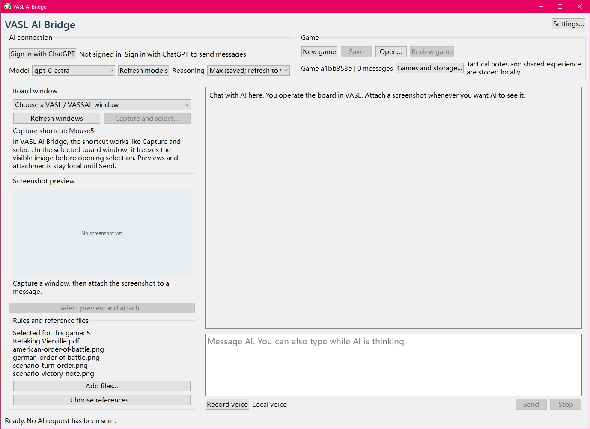
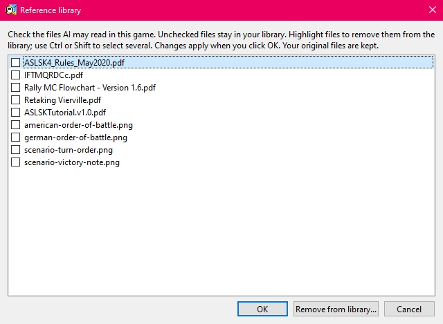
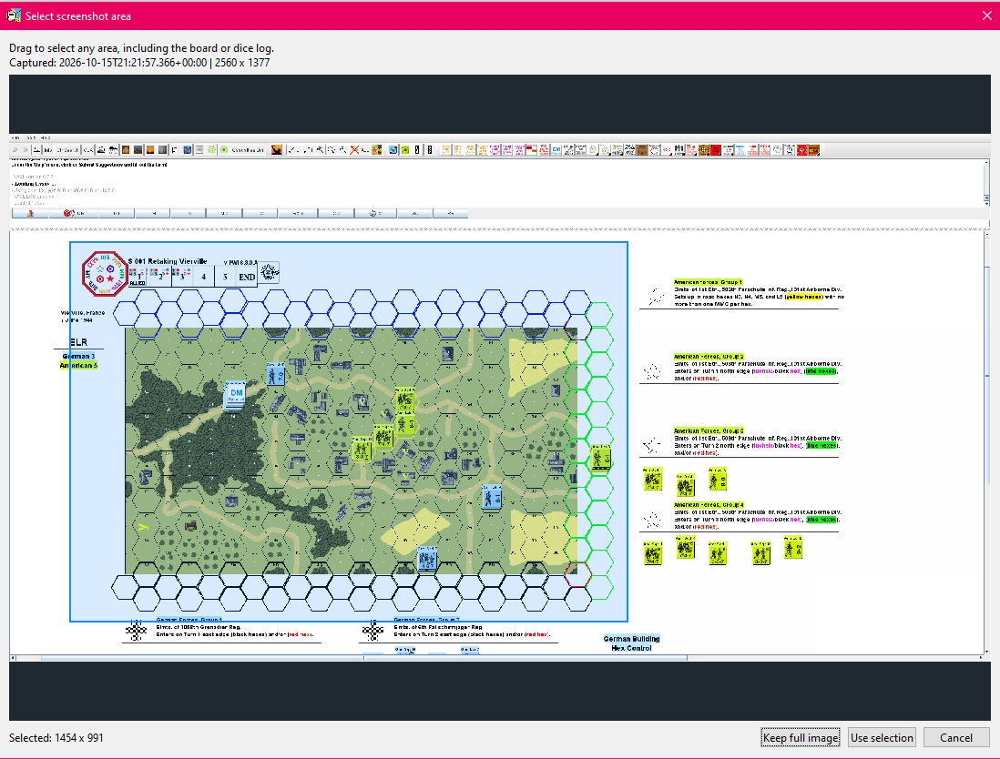
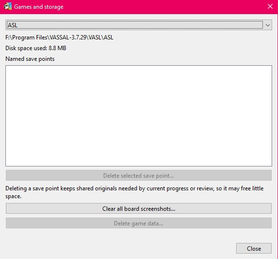
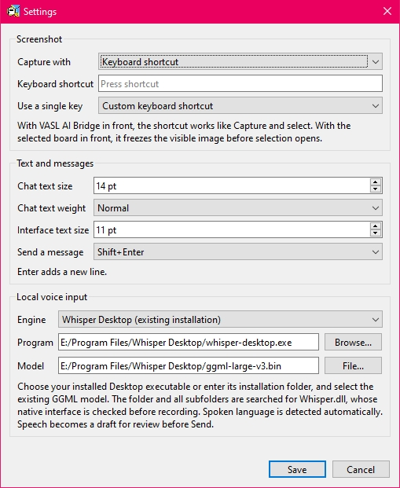

# VASL AI Bridge

### Windows warning and scan report / Windows 警告与扫描报告 / Windows 警告與掃描報告

** Windows SmartScreen 的“未识别的应用”警告属于下载文件的信誉检查，不等于检测到了病毒。安装包的病毒扫描结果见下方链接。

** Windows SmartScreen 的「無法辨識的應用程式」警告屬於下載檔案的信譽檢查，不等於偵測到了病毒。安裝程式的病毒掃描結果見下方連結。

** The Windows SmartScreen “unrecognised app” warning is a reputation warning for a downloaded file, not a malware detection result. See the shared link below for the VirusTotal scan report for the installer.

[VirusTotal scan report / 病毒扫描报告 / 病毒掃描報告](https://www.virustotal.com/gui/file/b362dc51091668a7d7d20cb3c98a9dc0f730f449a96688fbe708e618980a4912)

---

### Full-game review temporarily unavailable / 整局复盘暂时下线 / 整局復盤暫時下線

整局复盘暂时下线：复盘消耗用量过大，需要重新优化以后再上线。

整局復盤暫時下線：復盤消耗用量過大，需要重新優化以後再上線。

Full-game review is temporarily unavailable: it consumes too much usage allowance and must be optimized before it returns.

## English

[English](#english) | [简体中文](#zh-cn) | [繁體中文](#zh-tw)

[Known issues](#en-known-issues) · [Features](#en-features) · [Quick Start](#en-quick-start) · [Save and Continue](#en-save-and-continue) · [History and shared lessons](#en-history-and-review) · [Controls and Settings](#en-controls-and-settings) · [Privacy](#en-privacy) · [Credits](#en-credits) · [License](#en-license)

### Known issues

1. Resizing the window causes severe lag.
2. Try to resolve severe lag while generating replies.
3. After a reply, the conversation does not automatically scroll down to the latest reply.
4. Loading a save does not automatically scroll down to the last reply.
5. A single reply supports at most 8 images.
6. The screenshot window's default size is too small.
7. Hints are only in English.

**Play ASL with an AI opponent that can consult your references and return to your game record.**

VASL AI Bridge is a Windows companion for playing Advanced Squad Leader alongside VASL. It keeps selected rules, scenario materials, your conversation and board images available to the AI during play.

**Current AI support:** This version connects through **Sign in with ChatGPT** only. Other AI providers and API-key connections are not currently supported.

The AI chooses and explains its side's actions. You operate VASL: move counters, roll dice, check line of sight, resolve procedures and report the results.

### Features

- **References within reach.** Give the AI your rules, combat charts, scenario sheets and other materials. It can search readable text and inspect pages or images when it needs to check a detail.
- **Continue a game without starting the explanation again.** Keep the conversation, sent screenshots, selected references and a reviewed stopping-point report together. Open the game later and check the saved situation with the AI before continuing.
- **Discuss specific decisions using the original record.** Revisit an earlier exchange or screenshot and discuss a particular event. Tactical notes help distinguish what was intended from what actually happened.
- **Carry useful lessons into later games.** The AI records useful lessons during play. General lessons can be used across scenarios; scenario-specific lessons include the scenario name and are consulted only for that scenario.
- **Choose your interface language.** Use English, Simplified Chinese or Traditional Chinese. Change it in Settings and keep the same game, draft and attachments.

Voice input is optional. You can play entirely by typing and sending board screenshots.

*The main window. These screenshots show an earlier English interface. Click any screenshot to view it at full size.*

### Quick Start

#### Before you begin

##### Required

- A Windows 64-bit PC.
- [VASSAL](https://vassalengine.org/download.html) and the [VASL module](https://vasl.info/download.htm), with your scenario ready to open.
- The [ChatGPT desktop app for Windows](https://learn.chatgpt.com/docs/windows/windows-app), installed on the same PC. VASL AI Bridge uses its Codex component to connect to OpenAI. You do not need to operate the ChatGPT desktop app during a game.
- A ChatGPT account with access to Codex and a usable model. The application does not require a paid subscription; OpenAI controls which models and connection methods your account can use. See the Free/Go note below.
- An internet connection for sign-in and AI replies.
- Your own rules, combat charts and scenario materials. These are not supplied with VASL AI Bridge.

##### Recommended

- **ChatGPT Plus or a higher plan** for access to the Astra/Sol choices recommended below. The current Astra/Sol recommendations require Plus or higher; they are not Free/Go options. Actual access also depends on OpenAI's rollout and any workspace restrictions.
- **Optional voice input:** a microphone, a local Whisper speech engine and a separately downloaded speech model. For a straightforward setup, use **whisper.cpp for Windows x64** with the multilingual **GGML base model**. Download the engine and model manually; neither is included with VASL AI Bridge. The [voice setup steps](#en-optional-voice-input) are below. Typing supports the full game.

#### 1. Install and sign in

Download the Windows Setup installer from [Releases](https://github.com/lingqi19850821/VASL-AI-Bridge/releases), run it, then open **VASL AI Bridge** from the Start menu.

To choose the interface language, open **Settings... > Language / 语言**, select **English**, **简体中文** or **繁體中文**, then click **Save**. The interface changes immediately and remembers your choice. On first use, it follows your system display language when supported and otherwise uses English.

Click **Sign in with ChatGPT** and complete the browser sign-in. Return to VASL AI Bridge; the button changes to **Sign out** when sign-in succeeds. If you closed the browser page before finishing, click **Cancel sign-in** and try again.

The browser may ask you to choose an account to continue to **Codex**. This is expected: VASL AI Bridge uses the Codex component to connect to OpenAI. Use your ChatGPT account.

**Model** and **Reasoning** stay empty and disabled until you sign in. After sign-in, the model list loads automatically; choose a **Model** and **Reasoning**. Use **Refresh models** to reload the choices if needed. These selections are not restored after signing out or restarting. Available models and usage depend on your account; replies use its Codex allowance.

**Developer's recommendation — Plus or higher:** Start with **GPT-6.1 Sol** and **Reasoning: Max**, when offered by your account. This is my recommendation for your first game and for a session lasting several hours.

| Model | What it means for your game |
| --- | --- |
| **GPT-6 Astra** | OpenAI's flagship model for the most demanding work. Choose it when you want the strongest available capability and accept faster allowance consumption. On a limited plan, a long game may reach your usage limit sooner. |
| **GPT-6.1 Sol** | OpenAI describes it as close to Astra in capability at a lower cost. It usually uses less of your allowance, making it my recommended choice for learning the application or playing a long session. |

**Astra and Sol draw on the same account's Codex allowance.** Changing from Astra to Sol does not give you a fresh allowance. Using Sol can help that allowance last longer. How long it lasts depends on the game, conversation length, references consulted and reasoning setting; neither model guarantees a certain number of playing hours.

**What Max and Ultra mean:** Max gives the model more time to reason about one task. In OpenAI's own clients, Ultra can split suitable work among several AI agents working in parallel. VASL AI Bridge does not enable that parallel-agent workflow. For the tactical decisions of one ASL opponent, **my recommendation is Max**. Higher reasoning settings can take longer and use more of your allowance; response speed also varies with the model, workload and service conditions.

**Free or Go:** Choose **GPT-6 Luna** from **Model** when it is listed, or choose another model offered to your account. The Astra/Sol recommendations above are for Plus or higher. See [OpenAI's model overview](https://learn.chatgpt.com/docs/models) and [current plan information](https://learn.chatgpt.com/docs/pricing) for availability and usage limits.

#### 2. Create the game's folder

Open the scenario and starting board in VASL. In VASL AI Bridge, click **New game**.

Choose a **Location** where you want to keep the game, enter a **Game / folder name**, then click **Create game**. Choose a location you can write to, such as a folder in Documents.

This creates one folder for the conversation, references, screenshots and save points. You choose the location once; later saves stay inside that game folder.

#### 3. Add and select the references

Click **Add files...** to import your rules, relevant combat charts, scenario sheet and any useful images. Imported files enter a reusable local library and are selected for the current game.

Open **Choose references...**, check the boxes beside the files the AI should read, then click **OK**. The library can be reused in later games.

**A highlighted row is not a checked box.** In this screenshot, the first row is highlighted, but no files are checked. Tick the files you want the AI to use before clicking **OK**. See [Managing reference files](#en-managing-reference-files) for removal instructions.

Supply all rules needed by your scenario, including extra or module rules where applicable. Rules and charts may share one document or span several files. The AI is asked to check basic rule/chart readability before play; that check does not verify that every required rule is present. Supply anything it reports missing and clarify requirements through ordinary chat.

#### 4. Attach the starting board

Under **Board window**, select the VASL window containing your board. Click **Refresh windows** if it is missing.

Click **Capture and select...**. Drag around the area you want to show, then click **Use selection**, or choose **Keep full image**. Check the image attached to your draft. It stays local until you click **Send**.

#### 5. Start the conversation

Tell the AI which scenario you are playing, which side you want to control and the current turn and phase. Ask it to consult the selected materials, check the attached board and confirm the setup and victory conditions before play begins.

For example:

> Let's play the scenario in my references. I will play the Americans and you will play the Germans. Check the scenario, forces, setup and victory conditions against the attached starting board, and confirm where we should begin.

Change the sides to match your game, then click **Send**. You can use your preferred language.

During play, carry out the agreed actions in VASL and report dice, results, changed unit states and anything the AI cannot see. Send a fresh board image when needed. Check its interpretation of the board and rules, and correct misunderstandings in the same chat. **Stop** interrupts a reply when you need to intervene.

**You are ready to play.** Voice setup is optional and can wait until later.

### Save and Continue

#### Autosave: Current progress

**Every game folder has one autosave, shown as Current progress. You do not need to click Save to keep the conversation you have already sent.** The application updates this local record as you play. Each update replaces the previous autosave state with the latest progress, while retaining the game's stored conversation, screenshots and references.

Each game has its own autosave. Starting another game in a different folder keeps the first game's records in its original folder. To continue a game later, open its folder and choose **Current progress**.

#### Manual save points

Use **Save** when you want to keep a particular stopping point, such as the end of a turn, so you can return to it later. You can keep several named save points in the same game folder, just as a game can have one autosave and several manual saves:

1. Click **Save** to ask the AI for a game report.
2. Check the scenario, sides, objectives, turn and phase, important unit positions and states, and any unresolved actions.
3. Correct mistakes or omissions in the chat and review the updated report.
4. Click **Save point...**, which appears when the report is ready. Enter a name, or select an existing name and confirm overwriting it.
5. Save the matching board separately in VASL.

**Save** prepares the report; **Save point...** creates the named point. Several points share one game folder and the same stored originals, rather than copying every screenshot and reference into a separate complete archive each time.

Later autosaves do not overwrite your named save points. A named point stays available until you explicitly overwrite or delete it.

**If the AI becomes unavailable during play:** usage limits, a lost connection or a service interruption can prevent a new AI reply or save report. The application shows an error explaining the problem. Local **Current progress** records the conversation and screenshots you have already sent without requiring an AI reply. You can later reopen **Current progress**, then ask the AI to check and correct the stopping point once service is available again. **Save** still requests an AI report; it does not bypass an unavailable service. Check any local-save error before closing; unsent drafts and attachments are not part of the stored record. Save the matching board separately in VASL.

#### Continue later

1. Open the matching board save in VASL.
2. Open VASL AI Bridge and sign in if needed.
3. Click **Open...**. Choose the game, or use **Browse...** to select its folder.
4. Under **Continue from**, choose **Current progress** or a named save point, then click **Open**.
5. Attach a fresh board screenshot and ask the AI to check the saved situation before continuing.

**Keep both records:** VASL AI Bridge preserves the conversation and game record. The VASL board save preserves the board itself. Opening one does not restore the other. Close VASL AI Bridge before moving or copying a game, and keep its whole game folder together.

**Returning to an earlier save point does not roll back shared experience.** Later chat is excluded from that point's restored game context, but lessons already added to the common experience library can remain available and influence play.

#### Manage games and storage

Open **Games and storage...** to see each game's disk usage and named save points.

- **Delete selected save point...** removes that point. Shared originals needed by current progress or the game record remain, so it may free little space.
- **Clear all board screenshots...** clears the selected game's board images across **all** its save points. Chat, tactical notes, lessons and reference files remain, but the original board images can no longer be inspected when discussing earlier events. The application asks for confirmation.
- **Delete game data...** removes that game's managed records, points and materials. It preserves unrelated files and the shared experience library. The active game cannot be removed; switch to another game first.

Reference images, such as a scenario card or Order of Battle, are reference files and are kept when you clear board screenshots.

### History and shared lessons

Scroll back through the conversation yourself, or ask the AI to find an earlier exchange and inspect its original screenshot. The stored record remains available for lookup as a game grows.

For example:

> Find the earlier exchange about that movement and inspect its original screenshot. What result did I report, and which available rule source should we check for this decision?

The AI keeps tactical notes and records useful lessons from the results and corrections you provide. General lessons can be used across scenarios; scenario-specific lessons include the scenario name and are consulted only for that scenario. These lessons remain available when you switch models. Older lessons without a classification are preserved but excluded from these lookups.

Treat lessons as material to discuss and check against the rules and evidence. Models can make mistakes. A later explanation of an intention is not the same as an intention recorded at the time, and a screenshot that has been cleared is no longer available for inspection.

### Controls and Settings

#### Interface language

Open **Settings... > Language / 语言**, choose **English**, **简体中文** or **繁體中文**, then click **Save**. The change takes effect immediately and is kept for the next launch. Cancelling Settings keeps your previous choice.

The interface language does not change your existing chat, reference files, game names or model choice. You can chat in your preferred language; spoken language is still detected automatically.

#### ChatGPT and Codex

**ChatGPT** is the desktop application you install and the account you use to sign in. **Codex** is OpenAI's agent component within that application. VASL AI Bridge uses the local Codex runtime to connect to OpenAI with your ChatGPT account; this is why the name Codex appears in connection and usage information. You play through VASL AI Bridge and do not need to use the Codex interface during a game.

#### Connection and game controls

| Control | Purpose |
| --- | --- |
| **OpenAI status** | Open OpenAI's official service-status page in your browser. Located beside Settings... and available even before sign-in or while waiting for a reply. |
| **Sign in with ChatGPT / Sign out** | Connect or sign out. Signing out retains the local game and unsent draft. |
| **Cancel sign-in** | Cancel an unfinished browser sign-in so you can retry. |
| **Model / Refresh models** | Choose a model or update the available choices after signing in. |
| **Reasoning** | Choose an effort supported by the selected model for the current sign-in. |
| **New game** | Create a game folder and conversation, keeping the reusable reference library. |
| **Save / Save point...** | Prepare a reviewed report, then create or overwrite a named point. |
| **Open...** | Continue from a game's current progress or a named point. |
| **Games and storage...** | Inspect disk usage, manage points and clear game data. |

The memory status beside **Games and storage...** reports tactical notes, shared lessons or messages waiting to be recorded. Read any storage-error message before assuming those records have been saved.

If the server rejects a selected model for your account, the application asks you to choose another model or check your subscription. Usage limits, temporary request limits, expired sign-in and connection or service problems each show a corresponding message.

If replies are unusually slow or requests fail, click **OpenAI status** beside **Settings...** to check [OpenAI's service-status page](https://status.openai.com/). It reports published service incidents; individual users may experience different availability. This button opens a web page and does not send a message to AI.

#### Managing reference files

**Checkboxes control AI access; highlighted rows control removal. Ticking several boxes does not select those files for removal.**

- **Check a box** to let the AI read that file in the current game. **Uncheck it** to remove it from the current selection while keeping its imported copy in the library.
- **Click a file name** to highlight its row. Hold **Ctrl** while clicking to highlight several individual rows, or **Shift** to highlight a range.
- Click **Remove from library...**. Check the names and count in the confirmation, then choose **Yes**. This action uses the highlighted rows, whether their boxes are checked or unchecked.
- Click **OK** in Reference library to apply the changes. **Cancel** in that window discards pending changes.

Removal affects the imported library copies and the current game's reference selection. **Your original files on disk are kept.** You can import them again with **Add files...**.

Supported materials include PDF, DOCX, common text files and PNG, JPEG, WebP or BMP images. Readable text can be searched; PDF pages and reference images can be inspected visually. Keep document titles, editions and page references clear, and ask the AI to identify its source when a rule matters.

#### Board screenshots and messages

| Control | Purpose |
| --- | --- |
| **Board window / Refresh windows** | Select the VASL board to capture or refresh the window list. |
| **Capture and select...** | Capture the selected window and attach the full image or a chosen area to the draft. |
| **Select preview and attach...** | Select an area from the current preview and attach it to the draft. |
| **Remove** beside a draft image | Remove that attachment before sending. |
| **Send** | Send the draft and its attached screenshots. |
| **Stop** | Interrupt the current AI reply while retaining the conversation. |

Double-click **Screenshot preview**, or click **Screenshot** on a message, to inspect an image at full size. An attached image stays fixed even if the board or preview changes later. Capture is manual; images are shared when you send them.

Open **Settings... > Screenshot** to choose a keyboard shortcut or mouse side button. Shortcuts start disabled. Function keys are unavailable to avoid VASL conflicts. For a temporary display such as a line-of-sight check, keep the selected VASL window in front and use the shortcut while that display is visible.

#### Reading and input preferences

Under **Settings... > Text and messages**, adjust **Chat text size**, **Chat text weight** or **Interface text size**. Choose your preferred **Send a message** key and click **Save**. By default, Enter sends and Shift+Enter adds a new line.

The window adapts to the space available on your desktop. A smaller screen or larger Windows scaling may make the sidebar scroll. You can resize the window to suit your screen.

#### Optional voice input

Voice recognition needs a separately installed compatible speech engine and model. You can skip it and use all gameplay features by typing.

For the recommended Windows CPU setup:

1. Open the [whisper.cpp v1.8.2 release](https://github.com/ggml-org/whisper.cpp/releases/tag/v1.8.2). Under **Assets**, download **whisper-bin-x64.zip** and extract it. Keep the extracted files together.
2. Open the [Whisper model files](https://huggingface.co/ggerganov/whisper.cpp/tree/main) and manually download **ggml-base.bin**, the multilingual base model. The engine and model are separate downloads. The multilingual file has no **.en** in its name.
3. Open **Settings... > Local voice input**. Choose **whisper.cpp (CPU)**, set **Program** to the extracted **whisper-cli.exe**, set **Model** to **ggml-base.bin**, then click **Save**.
4. Click **Record voice**, speak, then click **Stop recording**. Review and edit the resulting draft before **Send**.

If you already have a compatible local installation, you can use **Automatic local engine (recommended)** or **Whisper Desktop (existing installation)** with its existing model instead. The application checks engine compatibility; a Desktop executable is not the same program as **whisper-cli.exe**.

Spoken language is detected automatically. **Cancel voice** cancels recording or transcription while preserving the existing draft and attachments. Voice configuration is independent of the first-game setup.

### Privacy

**Stored on your computer.** The reference library, game records, screenshots, tactical notes, shared experience and settings are stored locally. Game records and tactical journals are not encrypted. Notes may include the AI's tactical intentions; recreational fair play relies on players choosing whether to inspect them.

**Online requests go to OpenAI.** Sign-in and AI services connect to OpenAI through the local Codex runtime. The developer does not receive your conversations, reference files, screenshots or voice recordings through this application, and does not operate a server that collects them. Draft text and attachments remain on your computer until you send them. Sending a message or requesting an AI save report sends content to OpenAI; the AI can also consult selected references, earlier game records and shared lessons during that request. Asking about earlier events is still an online AI request. These materials go to OpenAI for the reply. Your use of OpenAI's services must follow its applicable [terms](https://openai.com/policies/terms-of-use/) and [Usage Policies](https://openai.com/policies/usage-policies/), including its safety and abuse-prevention rules. OpenAI handles the information it receives under its [Privacy Policy](https://openai.com/policies/privacy-policy/).

**Voice is transcribed locally.** The application uses your local speech engine and does not send the recording to OpenAI. The resulting text stays in your draft until you send it.

### Credits

Concept, requirements and product direction by [lingqi19850821](https://github.com/lingqi19850821). All original project code was written by OpenAI Codex under the developer's direction.

### License

VASL AI Bridge is licensed under the **GNU Affero General Public License v3.0**, AGPL-3.0-only. See the [project license](https://github.com/lingqi19850821/VASL-AI-Bridge/blob/main/LICENSE).

Third-party components retain their own licenses. See [Third-party notices](packaging/THIRD_PARTY_NOTICES.md).

[Back to language selection](#languages)

---

## 简体中文

[English](#english) | [简体中文](#zh-cn) | [繁體中文](#zh-tw)

[已知问题](#zh-cn-known-issues) · [功能](#zh-cn-features) · [快速开始](#zh-cn-quick-start) · [保存与继续](#zh-cn-save-and-continue) · [对局记录与经验](#zh-cn-history-and-review) · [操作与设置](#zh-cn-controls-and-settings) · [隐私](#zh-cn-privacy) · [致谢](#zh-cn-credits) · [许可证](#zh-cn-license)

### 已知问题

1. 窗口改变大小时非常卡顿
2. 尝试解决生成回复时非常卡顿
3. 回复之后不会自动下拉到最新的回复
4. 载入存档不会自动下拉到最后的回复
5. 一次回复最多8张图
6. 截图窗口默认大小太小
7. 提示只有英文

**与能够查阅你的参考资料、回看对局记录的 AI 对手一起玩 ASL。**

VASL AI Bridge 是一款 Windows 配套应用，用于在 VASL 中游玩 Advanced Squad Leader。它让 AI 在对局过程中能够访问你选定的规则、剧本资料、对话和棋盘图像。

**目前支持的 AI 连接方式：** 本版本仅支持**使用 ChatGPT 登录（Sign in with ChatGPT）**。目前不支持其他 AI 服务商或 API 密钥连接。

AI 负责决定并说明自己一方的行动。你负责操作 VASL：移动棋子、掷骰、检查视线、按规则处理结果，再把结果告诉 AI。

### 功能

- **随时查阅参考资料。** 向 AI 提供规则、战斗表、剧本卡及其他资料。需要核对细节时，它可以搜索可读文本，并查看页面或图像。
- **继续对局，无需从头解释。** 对话、已发送的截图、选定的参考资料和存档报告会保存在一起。下次打开对局，先与 AI 核对局面，再继续游戏。
- **依据原始记录讨论具体决策。** 回看某次早先的交流或截图，讨论特定事件。战术笔记有助于区分当时的意图和实际发生的结果。
- **将有用的经验带入后续对局。** AI 会记录对局中有用的经验。通用经验可用于不同剧本；剧本专用经验会注明剧本名称，只在同一剧本中查阅。
- **三种界面语言。** 支持 English、简体中文和繁體中文，可在设置中切换并记住选择。

语音输入为可选功能。你完全可以通过打字和发送棋盘截图来游玩。

*主窗口。截图来自较早的英文界面，点击任意截图即可查看原图。*

### 快速开始

#### 开始之前

##### 必需

- 一台 64 位 Windows 电脑。
- [VASSAL](https://vassalengine.org/download.html) 和 [VASL 模块](https://vasl.info/download.htm)，以及准备打开的剧本。
- 在同一台电脑上安装 [Windows 版 ChatGPT 桌面应用](https://learn.chatgpt.com/docs/windows/windows-app)。VASL AI Bridge 使用其中的 Codex 组件连接 OpenAI。对局过程中，你无需操作 ChatGPT 桌面应用。
- 一个能够使用 Codex 和可用模型的 ChatGPT 账户。应用本身不要求付费订阅；你的账户可以使用哪些模型和连接方式由 OpenAI 决定。请参阅下方的 Free/Go 说明。
- 用于登录和获取 AI 回复的互联网连接。
- 你自己的规则、战斗表和剧本资料。VASL AI Bridge 不提供这些内容。

##### 推荐

- **ChatGPT Plus 或更高等级的套餐**，用于访问下方推荐的 Astra/Sol 模型。目前的 Astra/Sol 推荐要求 Plus 或更高等级，不适用于 Free/Go。实际访问权限还取决于 OpenAI 的开放进度以及工作区限制。
- **可选语音输入：** 麦克风、本地 Whisper 语音引擎，以及单独下载的语音模型。较简单的配置是使用 **Windows x64 版 whisper.cpp** 搭配多语言 **GGML base 模型**。引擎和模型均需手动下载，VASL AI Bridge 不包含它们。下方提供[语音设置步骤](#zh-cn-optional-voice-input)。打字即可使用完整的对局功能。

#### 1. 安装并登录

从 [Releases](https://github.com/lingqi19850821/VASL-AI-Bridge/releases) 下载 Windows Setup 安装程序并运行，然后从开始菜单打开 **VASL AI Bridge**。

首次启动时，界面会跟随系统显示语言；不支持的语言使用英文。需要切换时，打开**设置...（Settings...）**，在 **Language / 语言** 中选择 **English、简体中文或繁體中文**，然后点击**保存（Save）**。界面会立即切换，并记住你的选择。界面语言与聊天语言、语音识别相互独立：它不会翻译已有的对话或参考资料，语音仍会自动识别所说的语言。

点击**使用 ChatGPT 登录**，在浏览器中完成登录，然后返回 VASL AI Bridge。登录成功后，按钮会变为**退出登录（Sign out）**。如果你在完成登录前关闭了浏览器页面，请点击**取消登录（Cancel sign-in）**后重试。

浏览器可能会要求你选择一个账户以继续使用 **Codex**。这是正常现象：VASL AI Bridge 使用 Codex 组件连接 OpenAI。使用你的 ChatGPT 账户即可。

登录前，**模型（Model）**和**推理强度（Reasoning）**保持空白且不可用。登录后，应用会自动加载模型列表；请选择**模型**和**推理强度**。需要时可点击**刷新模型（Refresh models）**重新加载选项。退出登录或重新启动后，不会恢复这些选择。可用模型和用量取决于你的账户；回复会使用其 Codex 额度。

**开发者推荐——Plus 或更高等级：** 如果你的账户提供相应选项，建议从 **GPT-6.1 Sol** 和 **推理强度：Max** 开始。这是我对第一次使用本应用，以及持续数小时的对局的推荐。

| 模型 | 对你的对局意味着什么 |
| --- | --- |
| **GPT-6 Astra** | OpenAI 面向最具挑战性工作的旗舰模型。如果你希望获得最强的可用能力，并能接受更快消耗额度，可以选择它。在额度有限的套餐中，长时间对局可能更早触及用量限制。 |
| **GPT-6.1 Sol** | OpenAI 将其描述为以更低成本提供接近 Astra 的能力。它通常消耗较少的额度，因此是我对熟悉应用或进行长时间对局的推荐。 |

**Astra 和 Sol 使用同一账户的 Codex 额度。** 从 Astra 切换到 Sol 不会获得一份新额度。使用 Sol 有助于让额度维持更久。实际能用多久，取决于对局、对话长度、查阅的参考资料和推理设置；两种模型都不保证固定的游玩时长。

**Max 和 Ultra 的含义：** Max 让模型有更多时间思考单个任务。在 OpenAI 自己的客户端中，Ultra 可以将合适的工作拆分给多个并行工作的 AI 代理。VASL AI Bridge 没有启用这种并行代理工作流。对于一名 ASL 对手的战术决策，**我的推荐是 Max**。更高的推理设置可能花费更长时间并消耗更多额度；回复速度也会随模型、工作量和服务状况变化。

**Free 或 Go：** 如果**模型**列表中提供 **GPT-6 Luna**，可以选择它，也可以选择账户提供的其他模型。上面的 Astra/Sol 推荐针对 Plus 或更高等级。有关可用性和用量限制，请参阅 [OpenAI 模型概览](https://learn.chatgpt.com/docs/models)和[当前套餐信息](https://learn.chatgpt.com/docs/pricing)。

#### 2. 创建对局文件夹

在 VASL 中打开剧本和初始棋盘。在 VASL AI Bridge 中点击**新建对局（New game）**。

选择保存对局的**位置（Location）**，输入**对局 / 文件夹名称（Game / folder name）**，然后点击**创建对局（Create game）**。请选择你有写入权限的位置，例如“文档”中的文件夹。

应用会创建一个文件夹，用于保存对话、参考资料、截图和存档点。你只需选择一次位置；后续保存都留在此对局文件夹内。

#### 3. 添加并选择参考资料

点击**添加文件...（Add files...）**，导入规则、相关战斗表、剧本卡和有用的图像。导入的文件会进入可重复使用的本地资料库，并被选中供当前对局使用。

打开**选择参考资料...（Choose references...）**，勾选允许 AI 阅读的文件旁的复选框，再点击**确定（OK）**。资料库可以在后续对局中重复使用。

**高亮行不等于已勾选的复选框。** 这张截图中的第一行处于高亮状态，但没有文件被勾选。点击**确定**之前，请先勾选你希望 AI 使用的文件。移除文件的操作见[管理参考文件](#zh-cn-managing-reference-files)。

请提供剧本所需的全部规则，包括适用的额外规则或模块规则。规则和图表可以合在一份文档，也可以分成多个文件。AI 会在对局开始前检查基本规则和图表能否读取，但这不保证资料已经齐全。请补充它指出缺少的资料，其他要求可直接在对话中说明。

#### 4. 附上初始棋盘

在**棋盘窗口（Board window）**下，选择包含棋盘的 VASL 窗口。如果没有显示，请点击**刷新窗口（Refresh windows）**。

点击**截图并选择区域...（Capture and select...）**。拖动以框选希望展示的区域，再点击**使用所选区域（Use selection）**，也可以选择**保留完整图像（Keep full image）**。检查附加到草稿中的图像。在点击**发送（Send）**前，它会一直留在本机。

#### 5. 开始对话

告诉 AI 你要玩的剧本、希望控制哪一方，以及当前回合和阶段。请它查阅选定的资料、检查所附棋盘，并在开始前确认初始配置和胜利条件。

例如：

> 我们来玩参考资料中的剧本。我控制美军，你控制德军。请根据附上的初始棋盘核对剧本、兵力、初始配置和胜利条件，并确认从哪里开始。

按你的对局修改双方，然后点击**发送**。你可以使用自己喜欢的语言。

对局过程中，在 VASL 中执行商定的行动，并报告骰点、结果、单位状态变化以及 AI 看不到的信息。需要时发送新的棋盘图像。请核对它对棋盘和规则的理解，并在同一对话中纠正误解。需要介入时，可以点击**停止（Stop）**中断回复。

**现在可以开始游玩了。** 语音设置是可选的，可以稍后再配置。

### 保存与继续

#### 自动保存：当前进度

**每个对局文件夹有一个自动存档，显示为当前进度（Current progress）。你无需点击“保存”，就能保留已经发送的对话。** 应用会在游玩过程中更新这份本地记录。每次更新都用最新进度替换先前的自动存档状态，同时保留该对局存储的对话、截图和参考资料。

每局对局都有自己的自动存档。在另一个文件夹中开始新对局，会将第一局的记录保留在原文件夹中。以后需要继续某局时，打开其文件夹并选择**当前进度**。

#### 手动存档点

如果想保留某一时刻的对局进度，例如一个回合结束时的局面，方便以后返回，请使用**保存**。同一个对局文件夹中可以保留多个命名存档，就像游戏可以同时保留自动存档和多个手动存档：

1. 点击**保存**，请 AI 准备一份对局报告。
2. 检查剧本、双方、目标、回合和阶段、重要单位的位置与状态，以及尚未解决的行动。
3. 在对话中纠正错误或遗漏，并核对更新后的报告。
4. 报告准备好后，点击出现的**存档点...（Save point...）**。输入名称，或选择现有名称并确认覆盖。
5. 在 VASL 中另外保存对应的棋盘。

**保存**用于准备报告；**存档点...**用于创建已命名的存档点。多个存档点共用一个对局文件夹和其中存储的原始资料，无需每次都将所有截图和参考资料复制成一份完整的独立档案。

后续自动保存不会覆盖已命名的存档点。它们会一直保留，直到你明确覆盖或删除。

**如果对局中 AI 暂时无法使用：** 额度用尽、连接中断或服务故障都可能导致 AI 无法回复，也无法生成存档报告。应用会显示相应错误。本地的**当前进度**仍会记录你已经发送的对话和截图。以后重新打开**当前进度**，等服务恢复后，再让 AI 核对局面。**保存**需要 AI 生成报告，因此也要等服务恢复后才能完成。关闭应用前，请留意是否有本地保存失败的提示；未发送的草稿和附件不会存入对局记录。对应的棋盘仍需在 VASL 中单独保存。

#### 稍后继续

1. 在 VASL 中打开对应的棋盘存档。
2. 打开 VASL AI Bridge，需要时登录。
3. 点击**打开...（Open...）**。选择对局，或使用**浏览...（Browse...）**选择其文件夹。
4. 在**继续位置（Continue from）**中选择**当前进度**或已命名的存档点，再点击**打开（Open）**。
5. 附上新的棋盘截图，请 AI 核对保存的局面后再继续。

**两种记录都要保留：** VASL AI Bridge 保存对话和对局记录，VASL 棋盘存档保存棋盘本身。打开其中一种不会恢复另一种。移动或复制对局之前，请先关闭 VASL AI Bridge，并将整个对局文件夹保存在一起。

**返回较早的存档点不会回退共享经验。** 该存档点之后的聊天不会进入它恢复的对局上下文，但已经加入共享经验库的经验仍可能可用，并影响后续游玩。

#### 管理对局与存储

打开**对局与存储...（Games and storage...）**，查看各局的磁盘占用和已命名的存档点。

- **删除选中的存档点...（Delete selected save point...）**只删除该存档点。当前进度或对局记录仍需使用的共用原始资料会保留，因此释放的空间可能很少。
- **清除所有棋盘截图...（Clear all board screenshots...）**会清除所选对局在**全部**存档点中的棋盘图像。聊天、战术笔记、经验和参考文件会保留，但讨论早先事件时将无法再查看这些原始棋盘图像。应用会要求确认。
- **删除对局数据...（Delete game data...）**会移除该对局由应用管理的记录、存档点和资料。无关文件和共享经验库会保留。当前正在使用的对局无法删除，请先切换到其他对局。

剧本卡或战斗序列（Order of Battle）等参考图像属于参考文件，清除棋盘截图时会保留。

### 对局记录与经验

你可以向上翻看对话，也可以请 AI 查找之前的对话和原始截图。对局记录会一直保留，方便随时查阅。

例如：

> 请找到早先有关那次移动的交流，并查看原始截图。我当时报告了什么结果？针对这个决策，我们应该核对哪份可用的规则来源？

AI 会记录战术笔记，并根据你提供的结果和纠正内容积累经验。通用经验可用于不同剧本；剧本专用经验会注明剧本名称，只在同一剧本中查阅。更换模型后，这些经验仍可使用。旧的未分类经验会保留，但不会混入上述两类经验的查询结果。

AI 也会犯错，使用这些经验时仍需核对规则和实际记录。事后的解释不代表当时的想法；已经清除的截图无法再次查看。

### 操作与设置

#### ChatGPT 与 Codex

**ChatGPT** 是你需要安装的桌面应用，也是你用于登录的账户。**Codex** 是该应用中的 OpenAI 代理组件。VASL AI Bridge 使用本地 Codex 运行时，通过你的 ChatGPT 账户连接 OpenAI；因此连接和用量信息中会出现 Codex 的名称。你通过 VASL AI Bridge 游玩，对局过程中无需使用 Codex 界面。

#### 连接与对局控件

| 控件 | 用途 |
| --- | --- |
| **OpenAI 服务状态（OpenAI status）** | 在浏览器中打开 OpenAI 官方服务状态页面。按钮位于“设置...”旁，登录前和等待回复时也可以使用。 |
| **使用 ChatGPT 登录 / 退出登录（Sign in with ChatGPT / Sign out）** | 连接或退出登录。退出登录会保留本地对局和未发送的草稿。 |
| **取消登录（Cancel sign-in）** | 取消尚未完成的浏览器登录，以便重试。 |
| **模型 / 刷新模型（Model / Refresh models）** | 登录后选择模型或更新可用选项。 |
| **推理强度（Reasoning）** | 选择当前登录状态下，所选模型支持的推理强度。 |
| **新建对局（New game）** | 创建对局文件夹和对话，同时保留可重复使用的参考资料库。 |
| **保存 / 存档点...（Save / Save point...）** | 准备并核对报告，然后创建或覆盖已命名的存档点。 |
| **打开...（Open...）** | 从某局的当前进度或已命名的存档点继续。 |
| **对局与存储...（Games and storage...）** | 查看磁盘占用、管理存档点和清除对局数据。 |

**对局与存储...**旁的记录状态会显示战术笔记、共享经验或等待记录的消息。确认这些内容已保存之前，请先阅读任何存储错误信息。

如果服务器拒绝你的账户使用所选模型，应用会提示你选择其他模型或检查订阅。用量限制、临时请求限制、登录过期、连接或服务问题也会显示各自对应的信息。

如果回复异常缓慢或请求失败，请点击**设置...**旁的 **OpenAI 服务状态**，查看 [OpenAI 服务状态页面](https://status.openai.com/)。它显示已公布的服务事件；个别用户的实际可用情况可能不同。此按钮只会打开网页，不会向 AI 发送消息。

#### 管理参考文件

**复选框控制 AI 的访问权限，高亮行控制移除操作。勾选多个复选框，不代表选中了这些文件以供移除。**

- **勾选复选框**，允许 AI 在当前对局中阅读该文件。**取消勾选**，则将它从当前选择中移除，但保留资料库内已导入的副本。
- **点击文件名**，高亮该行。按住 **Ctrl** 点击，可高亮多个独立的行；按住 **Shift**，可高亮连续范围。
- 点击**从资料库移除...（Remove from library...）**。检查确认窗口中的名称和数量，再选择**是（Yes）**。此操作使用高亮行，无论对应复选框是否勾选。
- 点击参考资料库中的**确定**，应用更改。在该窗口中点击**取消（Cancel）**，会放弃尚未应用的更改。

移除会影响资料库内的导入副本，以及当前对局选择的参考资料。**磁盘上的原始文件会保留。** 你可以通过**添加文件...**重新导入它们。

支持的资料包括 PDF、DOCX、常见文本文件，以及 PNG、JPEG、WebP 或 BMP 图像。可读文本可以搜索，PDF 页面和参考图像可以直接查看。请保持文档标题、版本和页码信息清晰；涉及重要规则时，请 AI 说明来源。

#### 棋盘截图与消息

| 控件 | 用途 |
| --- | --- |
| **棋盘窗口 / 刷新窗口（Board window / Refresh windows）** | 选择要截图的 VASL 棋盘，或刷新窗口列表。 |
| **截图并选择区域...（Capture and select...）** | 捕获所选窗口，并将完整图像或所选区域附加到草稿。 |
| **选择预览区域并附加...（Select preview and attach...）** | 从当前预览中选择区域，并附加到草稿。 |
| 草稿图像旁的**移除（Remove）** | 发送前移除该附件。 |
| **发送（Send）** | 发送草稿及其附带的截图。 |
| **停止（Stop）** | 中断当前 AI 回复，同时保留对话。 |

双击**截图预览（Screenshot preview）**，或点击消息上的**截图（Screenshot）**，可以按原始尺寸查看图像。附件一旦加入，内容就会固定，之后棋盘或预览发生变化也不会改变它。截图由你手动触发；发送时才会分享图像。

打开**设置... > 截图**，选择键盘快捷键或鼠标侧键。快捷键默认禁用。为避免与 VASL 冲突，不支持使用功能键。对于视线检查等临时显示内容，请让所选 VASL 窗口保持在前台，并在该内容仍显示时使用快捷键。

#### 界面语言

打开**设置... > Language / 语言**，选择 **English、简体中文或繁體中文**，再点击**保存**。界面会立即切换，并在下次启动时保留选择。首次启动时，应用跟随系统显示语言；不支持的语言使用英文。

界面语言与聊天和语音相互独立。切换界面不会翻译已有的对话或参考资料；你仍可使用自己喜欢的语言聊天，语音会继续自动识别所说的语言。

#### 阅读与输入偏好

在**设置... > 文字与消息（Text and messages）**中，调整**聊天文字大小（Chat text size）**、**聊天文字粗细（Chat text weight）**或**界面文字大小（Interface text size）**。选择偏好的**发送消息（Send a message）**按键，再点击**保存**。默认情况下，Enter 发送，Shift+Enter 换行。

窗口会根据桌面的可用空间调整。较小的屏幕或较大的 Windows 缩放比例，可能使侧栏需要滚动。你可以按自己的屏幕调整窗口大小。

#### 可选语音输入

语音识别需要单独安装兼容的语音引擎和模型。你可以跳过此功能，通过打字使用全部对局功能。

推荐的 Windows CPU 配置步骤如下：

1. 打开 [whisper.cpp v1.8.2 发布页](https://github.com/ggml-org/whisper.cpp/releases/tag/v1.8.2)。在 **Assets** 下下载 **whisper-bin-x64.zip** 并解压。请将解压后的文件保存在一起。
2. 打开 [Whisper 模型文件](https://huggingface.co/ggerganov/whisper.cpp/tree/main)，手动下载多语言 base 模型 **ggml-base.bin**。引擎和模型需要分别下载。多语言模型的文件名中没有 **.en**。
3. 打开**设置... > 本地语音输入（Local voice input）**。选择 **whisper.cpp（CPU）（whisper.cpp (CPU)）**，将**程序（Program）**设置为解压后的 **whisper-cli.exe**，将**模型**设置为 **ggml-base.bin**，再点击**保存**。
4. 点击**录音（Record voice）**，说话后点击**停止录音（Stop recording）**。检查并编辑生成的草稿，然后再**发送**。

如果已经有兼容的本地安装，也可以选择**自动选择本地引擎（推荐）（Automatic local engine (recommended)）**或 **Whisper Desktop（现有安装）（Whisper Desktop (existing installation)）**，并使用已有模型。应用会检查引擎兼容性；Desktop 可执行文件与 **whisper-cli.exe** 并不是同一个程序。

应用会自动识别所说的语言。**取消语音（Cancel voice）**会取消录音或转写，同时保留现有草稿和附件。语音配置与首次对局设置相互独立。

### 隐私

**保存在你的电脑上。** 参考资料库、对局记录、截图、战术笔记、共享经验和设置都保存在本机。对局记录和战术日志未加密。笔记可能包含 AI 的战术意图；休闲游玩的公平性，依靠玩家自行决定是否查看这些内容。

**在线请求发送给 OpenAI。** 登录和 AI 服务通过本地 Codex 运行时连接 OpenAI。开发者不会通过本应用收到你的对话、参考文件、截图或语音录音，也没有运营用于收集这些数据的服务器。草稿文字和附件会留在电脑上，直到你发送。发送消息或请求 AI 存档报告，都会向 OpenAI 发送内容；AI 也可以在请求过程中查阅选定的参考资料、较早的对局记录和共享经验。询问早先事件仍属于在线 AI 请求。这些资料会发送给 OpenAI，以生成回复。你对 OpenAI 服务的使用必须遵守其适用的[条款](https://openai.com/policies/terms-of-use/)和[使用政策](https://openai.com/policies/usage-policies/)，包括安全与防止滥用的规则。OpenAI 根据其[隐私政策](https://openai.com/policies/privacy-policy/)处理收到的信息。

**语音在本地转写。** 应用使用你的本地语音引擎，不会将录音发送给 OpenAI。生成的文字会留在草稿中，直到你发送。

### 致谢

概念、需求和产品方向由 [lingqi19850821](https://github.com/lingqi19850821) 提供。全部原始项目代码由 OpenAI Codex 在开发者指导下编写。

### 许可证

VASL AI Bridge 采用 **GNU Affero General Public License v3.0**，即 AGPL-3.0-only。请参阅[项目许可证](https://github.com/lingqi19850821/VASL-AI-Bridge/blob/main/LICENSE)。

第三方组件保留各自的许可证。请参阅[第三方声明](packaging/THIRD_PARTY_NOTICES.md)。

[返回语言选择](#languages)

---

## 繁體中文

[English](#english) | [简体中文](#zh-cn) | [繁體中文](#zh-tw)

[已知問題](#zh-tw-known-issues) · [功能特色](#zh-tw-features) · [快速開始](#zh-tw-quick-start) · [儲存與繼續](#zh-tw-save-and-continue) · [對局紀錄與經驗](#zh-tw-history-and-review) · [控制項與設定](#zh-tw-controls-and-settings) · [隱私](#zh-tw-privacy) · [製作人員](#zh-tw-credits) · [授權](#zh-tw-license)

### 已知問題

1. 窗口改變大小時非常卡頓
2. 嘗試解決生成回覆時非常卡頓
3. 回覆之後不會自動下拉到最新的回覆
4. 載入存檔不會自動下拉到最後的回覆
5. 一次回覆最多8張圖
6. 截圖窗口默認大小太小
7. 提示只有英文

**與能查閱你的參考資料、隨時回顧對局紀錄的 AI 對手一起玩 ASL。**

VASL AI Bridge 是搭配 VASL 遊玩 Advanced Squad Leader 的 Windows 輔助應用程式。遊玩期間，AI 可以使用你選取的規則、劇本資料、對話與棋盤影像。

**目前支援的 AI 連線方式：** 此版本僅支援**使用 ChatGPT 登入（Sign in with ChatGPT）**。目前不支援其他 AI 服務供應商或 API 金鑰連線。

AI 負責決定並說明自己一方的行動。你負責操作 VASL：移動棋子、擲骰、檢查視線、依規則處理結果，再把結果告訴 AI。

### 功能特色

- **隨時查閱參考資料。** 提供規則、戰鬥表、劇本卡與其他資料。AI 可以搜尋可讀文字，並在需要確認細節時查看頁面或影像。
- **繼續對局，無須重新解釋一切。** 將對話、已傳送的截圖、選取的參考資料，以及經你檢查的停局報告保存在一起。稍後重新開啟對局，先與 AI 核對已儲存的局面，再繼續遊玩。
- **依據原始紀錄討論具體決策。** 重看某次先前的對話或截圖，討論特定事件。戰術記錄有助於區分當時的意圖與實際發生的事情。
- **將有用經驗帶入後續對局。** AI 會記錄對局中有用的經驗。通用經驗可用於不同劇本；劇本專用經驗會註明劇本名稱，只在同一劇本中查閱。
- **三種介面語言。** 可選擇 English、简体中文或繁體中文。儲存設定後立即生效，下次啟動也會保留選擇；介面語言與聊天語言、語音辨識的自動語言偵測互相獨立。

語音輸入是選用功能。完全透過打字與傳送棋盤截圖，也能進行整場對局。

*主視窗。截圖來自較早的英文介面，點選任何截圖即可查看原圖。*

### 快速開始

#### 開始之前

##### 必備項目

- Windows 64 位元電腦。
- [VASSAL](https://vassalengine.org/download.html) 與 [VASL 模組](https://vasl.info/download.htm)，並準備好要開啟的劇本。
- 在同一台電腦安裝 [Windows 版 ChatGPT 桌面應用程式](https://learn.chatgpt.com/docs/windows/windows-app)。VASL AI Bridge 使用其中的 Codex 元件連線至 OpenAI。對局期間，你不需要操作 ChatGPT 桌面應用程式。
- 能使用 Codex 及可用模型的 ChatGPT 帳號。應用程式不要求付費訂閱；你的帳號可使用哪些模型與連線方式，由 OpenAI 決定。請參閱下方的 Free／Go 說明。
- 網際網路連線，用於登入及接收 AI 回覆。
- 你自己的規則、戰鬥表與劇本資料。VASL AI Bridge 不提供這些資料。

##### 建議項目

- **ChatGPT Plus 或更高方案**，以使用下方建議的 Astra／Sol 選項。目前的 Astra／Sol 建議需要 Plus 或更高方案，不適用於 Free／Go。實際存取權也取決於 OpenAI 的開放進度及工作區限制。
- **選用語音輸入：** 麥克風、本機 Whisper 語音引擎，以及另外下載的語音模型。若希望設定簡單，建議使用 **Windows x64 版 whisper.cpp** 搭配多語言的 **GGML base 模型**。請手動下載引擎與模型；VASL AI Bridge 均未隨附。下方提供[語音設定步驟](#zh-tw-optional-voice-input)。打字即可使用完整的對局功能。

#### 1. 安裝並登入

從 [Releases](https://github.com/lingqi19850821/VASL-AI-Bridge/releases) 下載 Windows Setup 安裝程式，執行後，從開始功能表開啟 **VASL AI Bridge**。

若要切換介面語言，開啟**設定...（Settings...）> Language / 語言**，選擇 **English／简体中文／繁體中文**，再按**儲存（Save）**。語言會立即切換並保留至下次啟動。首次啟動且尚未儲存選擇時，應用程式會依系統顯示語言選用簡體中文或繁體中文；其他語言使用英文。這項選擇不會變更聊天語言，語音輸入仍會自動偵測所說的語言。

按**使用 ChatGPT 登入（Sign in with ChatGPT）**，並在瀏覽器中完成登入。回到 VASL AI Bridge；登入成功後，按鈕會變為**登出（Sign out）**。如果在完成前關閉了瀏覽器頁面，請按**取消登入（Cancel sign-in）**後重試。

瀏覽器可能要求你選擇帳號以繼續使用 **Codex**。這是正常情況：VASL AI Bridge 透過 Codex 元件連線至 OpenAI。請使用你的 ChatGPT 帳號。

登入前，**模型（Model）**與**推理強度（Reasoning）**會保持空白且無法操作。登入後，模型清單會自動載入；請選擇**模型**與**推理強度**。如有需要，可按**重新整理模型（Refresh models）**重新載入選項。登出或重新啟動後，不會還原這些選擇。可用模型與使用量取決於你的帳號；回覆會使用該帳號的 Codex 額度。

**開發者建議——Plus 或更高方案：** 如果你的帳號提供這些選項，請從 **GPT-6.1 Sol** 搭配 **推理強度：Max** 開始。這是我對第一場對局及持續數小時遊玩時段的建議。

| 模型 | 對你的對局有何影響 |
| --- | --- |
| **GPT-6 Astra** | OpenAI 用於最具挑戰性工作的旗艦模型。若你希望使用最強的可用能力，並願意接受較快的額度消耗，可以選擇它。在額度有限的方案中，長時間對局可能較早觸及使用量上限。 |
| **GPT-6.1 Sol** | OpenAI 將它描述為以較低成本提供接近 Astra 的能力。它通常消耗較少額度，因此是我建議用來熟悉應用程式或進行長時間對局的選擇。 |

**Astra 與 Sol 使用同一個帳號的 Codex 額度。** 從 Astra 切換為 Sol 不會獲得一份新額度。使用 Sol 可以讓額度維持更久。實際能使用多久，取決於對局、對話長度、查閱的參考資料與推理設定；兩種模型都不保證能遊玩特定時數。

**Max 與 Ultra 的意義：** Max 讓模型有更多時間思考單一任務。在 OpenAI 自己的用戶端中，Ultra 可以將適合的工作分給多個 AI 代理並行處理。VASL AI Bridge 未啟用這種平行代理工作流程。對於一名 ASL 對手的戰術決策，**我的建議是 Max**。較高的推理設定可能需要更長時間，也會消耗更多額度；回應速度還會隨模型、工作量與服務狀況而變化。

**Free 或 Go：** 如果**模型**清單中列有 **GPT-6 Luna**，可選擇它，或選擇帳號提供的其他模型。上述 Astra／Sol 建議適用於 Plus 或更高方案。可用選項與使用量限制，請參閱 [OpenAI 模型總覽](https://learn.chatgpt.com/docs/models)及[目前的方案資訊](https://learn.chatgpt.com/docs/pricing)。

#### 2. 建立對局資料夾

在 VASL 中開啟劇本與起始棋盤。在 VASL AI Bridge 中，按**建立對局（New game）**。

選擇要儲存對局的**位置（Location）**，輸入**對局 / 資料夾名稱（Game / folder name）**，再按**建立對局（Create game）**。請選擇可以寫入的位置，例如「文件」中的資料夾。

這會建立一個資料夾，集中儲存對話、參考資料、截圖與存檔點。你只需選擇一次位置；之後的儲存都會留在該對局資料夾內。

#### 3. 加入並選擇參考資料

按**加入檔案...（Add files...）**，匯入規則、相關戰鬥表、劇本卡與有用的影像。匯入的檔案會加入可重複使用的本機資料庫，並自動選為目前對局的參考資料。

開啟**選擇參考資料...（Choose references...）**，勾選要讓 AI 讀取的檔案，再按**確定（OK）**。之後的對局也能重複使用此資料庫。

**反白的資料列不代表核取方塊已勾選。** 這張截圖中，第一列已反白，但沒有任何檔案被勾選。請先勾選要讓 AI 使用的檔案，再按**確定**。移除方式請參閱[管理參考檔案](#zh-tw-managing-reference-files)。

請提供劇本所需的全部規則，包括適用的額外規則或模組規則。規則與表格可以集中於同一份文件，也可以分散於多個檔案。AI 會在開始前檢查基本規則與表格是否可讀；這項檢查不會驗證所有必要規則是否齊全。請補充 AI 回報缺少的資料，並透過一般聊天釐清需求。

#### 4. 附上起始棋盤

在**棋盤視窗（Board window）**下，選擇包含棋盤的 VASL 視窗。若未列出，請按**重新整理視窗（Refresh windows）**。

按**擷取並選取範圍...（Capture and select...）**。拖曳選取要顯示的範圍，再按**使用選取區域（Use selection）**，或選擇**保留完整影像（Keep full image）**。檢查附加至草稿的影像；在你按**傳送（Send）**前，它會留在本機。

#### 5. 開始對話

告訴 AI 你要玩的劇本、自己要控制哪一方，以及目前的回合與階段。請它查閱選取的資料、檢查附上的棋盤，並在開始前確認部署與勝利條件。

例如：

> 我們來玩參考資料裡的劇本。我扮演美軍，你扮演德軍。請根據附上的起始棋盤核對劇本、部隊、部署與勝利條件，並確認我們應該從哪裡開始。

將雙方改成符合你的對局，再按**傳送**。你可以使用自己偏好的語言。

遊玩期間，在 VASL 中執行雙方同意的行動，並回報擲骰、結果、單位狀態的變化，以及 AI 看不到的情況。需要時傳送新的棋盤影像。檢查 AI 對棋盤與規則的理解，並在同一段對話中更正誤解。需要介入時，**停止（Stop）**可以中斷回覆。

**現在可以開始遊玩了。** 語音設定是選用項目，可以之後再處理。

### 儲存與繼續

#### 自動儲存：目前進度

**每個對局資料夾都有一份自動儲存，顯示為「目前進度（Current progress）」。要保留已傳送的對話，不需要按「儲存」。** 應用程式會在遊玩期間更新這份本機紀錄。每次更新都會以最新進度取代上一份自動儲存狀態，同時保留對局已儲存的對話、截圖與參考資料。

每場對局都有自己的自動儲存。在另一個資料夾開始新對局，不會移除第一場對局的原有紀錄。稍後要繼續時，開啟該對局資料夾並選擇**目前進度**。

#### 手動存檔點

如果你想保留特定停局位置，例如回合結束時的狀態，以便日後返回，請使用**儲存（Save）**。同一個對局資料夾可以保留多個已命名的存檔點，就像一場遊戲可以同時有一份自動儲存與多份手動存檔：

1. 按**儲存**，請 AI 準備對局報告。
2. 檢查劇本、雙方、目標、回合與階段、重要單位的位置與狀態，以及尚未解決的行動。
3. 在聊天中更正錯誤或遺漏，並檢查更新後的報告。
4. 報告準備完成後，按出現的**存檔點...（Save point...）**。輸入名稱，或選擇現有名稱並確認覆寫。
5. 在 VASL 中另行儲存相符的棋盤。

**儲存**用來準備報告；**存檔點...**用來建立已命名的存檔點。多個存檔點共用同一個對局資料夾與已儲存的原始資料，不會每次都將所有截圖與參考資料複製成另一份完整封存。

之後的自動儲存不會覆寫已命名的存檔點。除非你明確覆寫或刪除，已命名的存檔點會一直保留。

**如果遊玩期間 AI 無法使用：** 使用量上限、連線中斷或服務異常，可能導致無法取得新的 AI 回覆或存局報告。應用程式會顯示說明問題的錯誤訊息。本機的**目前進度**不需要 AI 回覆，就能記錄已傳送的對話與截圖。稍後服務恢復後，你可以重新開啟**目前進度**，再請 AI 檢查並更正停局位置。**儲存**仍然會請求 AI 報告，無法繞過無法使用的服務。關閉前請檢查任何本機儲存錯誤；未傳送的草稿與附件不屬於已儲存紀錄。請在 VASL 中另行儲存相符的棋盤。

#### 稍後繼續

1. 在 VASL 中開啟相符的棋盤存檔。
2. 開啟 VASL AI Bridge，並在需要時登入。
3. 按**開啟...（Open...）**。選擇對局，或按**瀏覽...（Browse...）**選擇其資料夾。
4. 在**繼續位置（Continue from）**下，選擇**目前進度**或已命名的存檔點，再按**開啟（Open）**。
5. 附上新的棋盤截圖，請 AI 先核對已儲存的局面，再繼續遊玩。

**兩種紀錄都要保留：** VASL AI Bridge 保留對話與對局紀錄；VASL 棋盤存檔保留棋盤本身。開啟其中一種，不會還原另一種。移動或複製對局前，請先關閉 VASL AI Bridge，並將整個對局資料夾一起保留。

**返回較早的存檔點，不會讓共享經驗回復到較早狀態。** 該存檔點還原的對局上下文不包含之後的聊天，但已加入共享經驗庫的經驗仍可能繼續供 AI 使用並影響遊玩。

#### 管理對局與儲存空間

開啟**對局與儲存空間...（Games and storage...）**，查看各場對局的磁碟用量及已命名的存檔點。

- **刪除選取的存檔點...（Delete selected save point...）**會移除該存檔點。目前進度或對局紀錄所需的共用原始資料仍會保留，因此可能只釋出少量空間。
- **清除所有棋盤截圖...（Clear all board screenshots...）**會清除所選對局**全部**存檔點中的棋盤影像。聊天、戰術記錄、經驗與參考檔案仍會保留，但討論先前事件時將無法再查看那些原始棋盤影像。應用程式會要求確認。
- **刪除對局資料...（Delete game data...）**會移除該對局由應用程式管理的紀錄、存檔點與資料。無關檔案及共享經驗庫會保留。目前使用中的對局不能刪除；請先切換至另一場對局。

劇本卡或部隊編制（Order of Battle）等參考影像屬於參考檔案，清除棋盤截圖時仍會保留。

### 對局紀錄與經驗

你可以往上翻閱對話，也可以請 AI 查找先前的對話與原始截圖。對局紀錄會持續保留，方便隨時查閱。

例如：

> 請找出先前關於那次移動的對話，並查看原始截圖。我當時回報了什麼結果？針對這個決策，我們應該核對哪份可用的規則來源？

AI 會保留戰術筆記，並根據你提供的結果與更正累積經驗。通用經驗可用於不同劇本；劇本專用經驗會註明劇本名稱，只在同一劇本中查閱。更換模型後，這些經驗仍可使用。舊的未分類經驗會保留，但不會混入上述兩類經驗的查詢結果。

AI 也會犯錯，使用這些經驗時仍需核對規則與實際紀錄。事後的解釋不代表當時的想法；已經清除的截圖無法再次查看。

### 控制項與設定

#### ChatGPT 與 Codex

**ChatGPT** 是你安裝的桌面應用程式，也是你用來登入的帳號。**Codex** 是該應用程式中的 OpenAI 代理元件。VASL AI Bridge 使用本機 Codex 執行環境，透過你的 ChatGPT 帳號連線至 OpenAI；因此，連線與使用量資訊會出現 Codex 這個名稱。你透過 VASL AI Bridge 遊玩，對局期間不需要使用 Codex 介面。

#### 介面語言

開啟**設定...（Settings...）> Language / 語言**，選擇 **English／简体中文／繁體中文**，再按**儲存（Save）**。成功儲存後，介面會立即切換，並在之後啟動時保留選擇。按**取消（Cancel）**不會套用選擇。尚未儲存選擇時，應用程式依系統顯示語言選用簡體中文或繁體中文；其他語言使用英文。

介面語言只影響應用程式的控制項與提示。你仍可用偏好的語言聊天，語音輸入仍自動偵測所說的語言。

#### 連線與對局控制項

| 控制項 | 用途 |
| --- | --- |
| **OpenAI 服務狀態（OpenAI status）** | 在瀏覽器中開啟 OpenAI 官方服務狀態頁。位於「設定...」旁，尚未登入或正在等候回覆時也可使用。 |
| **使用 ChatGPT 登入／登出（Sign in with ChatGPT / Sign out）** | 連線或登出。登出後會保留本機對局與未傳送的草稿。 |
| **取消登入（Cancel sign-in）** | 取消尚未完成的瀏覽器登入，以便重試。 |
| **模型／重新整理模型（Model / Refresh models）** | 登入後選擇模型，或更新可用選項。 |
| **推理強度（Reasoning）** | 選擇目前登入狀態下，所選模型支援的推理強度。 |
| **建立對局（New game）** | 建立對局資料夾與對話，並保留可重複使用的參考資料庫。 |
| **儲存／存檔點...（Save / Save point...）** | 準備經你檢查的報告，再建立或覆寫已命名的存檔點。 |
| **開啟...（Open...）** | 從對局的目前進度或已命名的存檔點繼續。 |
| **對局與儲存空間...（Games and storage...）** | 查看磁碟用量、管理存檔點及清除對局資料。 |

**對局與儲存空間...**旁的記憶狀態會顯示戰術記錄、共享經驗或等待記錄的訊息。確認紀錄已儲存前，請先閱讀任何儲存錯誤訊息。

如果伺服器拒絕你的帳號使用所選模型，應用程式會請你選擇其他模型或檢查訂閱。使用量上限、暫時的請求限制、登入失效，以及連線或服務問題，都會顯示對應訊息。

如果回覆異常緩慢或請求失敗，請按**設定...**旁的**OpenAI 服務狀態**，查看 [OpenAI 服務狀態頁](https://status.openai.com/)。該頁報告已公布的服務事件；個別使用者的實際可用情況可能不同。這個按鈕只會開啟網頁，不會向 AI 傳送訊息。

#### 管理參考檔案

**核取方塊控制 AI 的存取權；反白資料列控制移除對象。勾選多個方塊，不代表選取那些檔案供移除。**

- **勾選方塊**，讓 AI 在目前對局中讀取該檔案。**取消勾選**會將它移出目前的選取清單，但仍保留資料庫中的匯入副本。
- **點選檔案名稱**，讓該列反白。按住 **Ctrl** 點選可反白多個個別資料列；按住 **Shift** 可反白一段範圍。
- 按**從資料庫移除...（Remove from library...）**。檢查確認視窗中的名稱與數量，再選擇**是（Yes）**。這項操作以反白資料列為準，不受其核取方塊是否勾選影響。
- 在參考資料庫中按**確定（OK）**套用變更。該視窗中的**取消（Cancel）**會放棄尚未套用的變更。

移除會影響匯入資料庫的副本，以及目前對局的參考資料選擇。**磁碟上的原始檔案會保留。** 你可以使用**加入檔案...**重新匯入。

支援的資料包括 PDF、DOCX、常見文字檔，以及 PNG、JPEG、WebP 或 BMP 影像。可讀文字可以搜尋；PDF 頁面與參考影像可以直接檢視。請清楚標示文件標題、版本與頁碼；重要規則出現時，請 AI 指出來源。

#### 棋盤截圖與訊息

| 控制項 | 用途 |
| --- | --- |
| **棋盤視窗／重新整理視窗（Board window / Refresh windows）** | 選擇要擷取的 VASL 棋盤，或重新整理視窗清單。 |
| **擷取並選取範圍...（Capture and select...）** | 擷取所選視窗，將完整影像或選取區域附加至草稿。 |
| **選取預覽範圍並附加...（Select preview and attach...）** | 從目前預覽選取區域，並附加至草稿。 |
| 草稿影像旁的**移除（Remove）** | 在傳送前移除該附件。 |
| **傳送（Send）** | 傳送草稿及其附加的截圖。 |
| **停止（Stop）** | 中斷目前的 AI 回覆，同時保留對話。 |

按兩下**截圖預覽（Screenshot preview）**，或按訊息上的**截圖（Screenshot）**，即可依原始尺寸檢視影像。即使之後棋盤或預覽改變，已附加的影像仍保持固定。截圖由你手動擷取；影像會在你傳送時才分享出去。

開啟**設定... > 截圖（Screenshot）**，選擇鍵盤快速鍵或滑鼠側鍵。快速鍵預設為停用。為避免與 VASL 衝突，無法使用功能鍵。若要擷取視線檢查等暫時畫面，請讓選取的 VASL 視窗保持在前景，並在該畫面可見時使用快速鍵。

#### 閱讀與輸入偏好

在**設定... > 文字與訊息（Text and messages）**中，調整**聊天文字大小（Chat text size）**、**聊天文字粗細（Chat text weight）**或**介面文字大小（Interface text size）**。選擇偏好的**傳送訊息（Send a message）**按鍵，再按**儲存**。預設為 Enter 傳送、Shift+Enter 換行。

視窗會配合桌面可用空間調整。較小螢幕或較大的 Windows 縮放比例，可能讓側欄需要捲動。你可以自行調整視窗大小以配合螢幕。

#### 選用語音輸入

語音辨識需要另外安裝相容的語音引擎與模型。你可以略過此設定，透過打字使用全部對局功能。

建議的 Windows CPU 設定步驟：

1. 開啟 [whisper.cpp v1.8.2 發行頁](https://github.com/ggml-org/whisper.cpp/releases/tag/v1.8.2)。在 **Assets** 下下載 **whisper-bin-x64.zip** 並解壓縮。請將解壓縮後的檔案保留在一起。
2. 開啟 [Whisper 模型檔案](https://huggingface.co/ggerganov/whisper.cpp/tree/main)，手動下載多語言 base 模型 **ggml-base.bin**。引擎與模型需要分別下載。多語言檔案的名稱不含 **.en**。
3. 開啟**設定... > 本機語音輸入（Local voice input）**。選擇 **whisper.cpp（CPU）**，將**程式（Program）**設為解壓縮後的 **whisper-cli.exe**，將**模型（Model）**設為 **ggml-base.bin**，再按**儲存**。
4. 按**錄音（Record voice）**開始說話，然後按**停止錄音（Stop recording）**。在**傳送**前，先檢查並編輯產生的草稿。

如果已安裝相容的本機引擎，也可以改用**自動選擇本機引擎（建議）（Automatic local engine (recommended)）**，或**Whisper Desktop（現有安裝）（Whisper Desktop (existing installation)）**搭配現有模型。應用程式會檢查引擎相容性；Desktop 執行檔與 **whisper-cli.exe** 並非同一個程式。

系統會自動偵測所說的語言。**取消語音（Cancel voice）**可取消錄音或轉寫，同時保留現有草稿與附件。語音設定與第一場對局的設定互相獨立。

### 隱私

**儲存在你的電腦上。** 參考資料庫、對局紀錄、截圖、戰術記錄、共享經驗與設定均儲存在本機。對局紀錄與戰術日誌未加密。記錄可能包含 AI 的戰術意圖；休閒對局的公平性，取決於玩家自行選擇是否查看這些內容。

**線上請求會傳送至 OpenAI。** 登入及 AI 服務透過本機 Codex 執行環境連線至 OpenAI。開發者不會透過本應用程式接收你的對話、參考檔案、截圖或錄音，也未營運蒐集這些資料的伺服器。草稿文字與附件會留在你的電腦上，直到你傳送為止。傳送訊息或請求 AI 存局報告，都會將內容傳送至 OpenAI；在該次請求中，AI 也可以查閱選取的參考資料、較早的對局紀錄及共享經驗。詢問先前事件仍屬於線上 AI 請求。這些資料會傳送至 OpenAI，以產生回覆。使用 OpenAI 服務時，必須遵守適用的[使用條款](https://openai.com/policies/terms-of-use/)與[使用政策](https://openai.com/policies/usage-policies/)，包括其安全及防止濫用規則。OpenAI 會依其[隱私政策](https://openai.com/policies/privacy-policy/)處理收到的資訊。

**語音在本機轉寫。** 應用程式使用你的本機語音引擎，不會將錄音傳送至 OpenAI。轉寫後的文字會留在草稿中，直到你傳送為止。

### 製作人員

概念、需求與產品方向由 [lingqi19850821](https://github.com/lingqi19850821) 提出。專案全部原創程式碼皆由 OpenAI Codex 在開發者指導下撰寫。

### 授權

VASL AI Bridge 採用 **GNU Affero General Public License v3.0**，AGPL-3.0-only 授權。請參閱[專案授權](https://github.com/lingqi19850821/VASL-AI-Bridge/blob/main/LICENSE)。

第三方元件保留各自的授權。請參閱[第三方聲明](packaging/THIRD_PARTY_NOTICES.md)。

[返回語言選擇](#languages)
